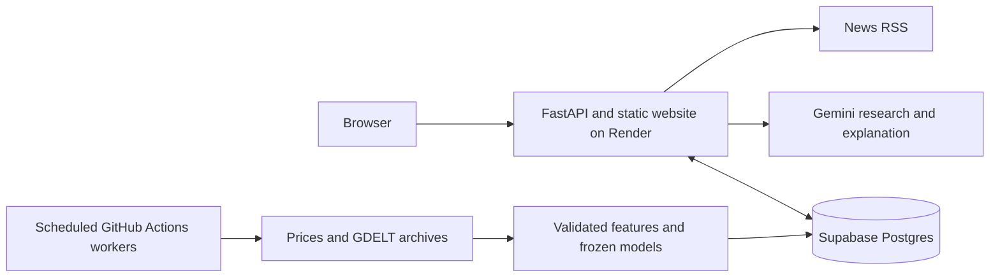

# YodaX

[Open YodaX](https://yodax-99lp.onrender.com/) · [AI chat](https://yodax-99lp.onrender.com/workspace.html?view=future) · [Documentation](docs/README.md)

YodaX brings market research and measurable forecasts into one workspace. Ask about a stock or commodity, inspect the sources and mind map, and compare saved predictions with what the market actually did.

**Current release: 0.3.0-beta.1.** This is a research beta. It has not established a trading advantage.

## What works today

| Area | Current scope |
| --- | --- |
| Daily dashboard | Next-session forecasts for AAPL, MSFT, GOOGL, TSLA, NVDA and AMZN |
| Event-aware chat forecasts | Five-session forecasts for 21 US stocks, WTI and copper price proxies |
| Other numerical requests | Supported US equities and WTI/copper, 1–60 sessions, using TimesFM outside the event model's scope |
| Research chat | Stocks, commodities, forex and financial questions, with sources, follow-ups and evidence maps |
| Reports and evaluation | Exportable research reports, saved forecasts, settled outcomes and model comparisons |

The event model combines a TimesFM price forecast with price/volume features, market context and structured GDELT event statistics. Gemini researches and explains the results. Free-form headlines do not directly change numerical predictions. Silicon, lithium, steel, Brent and forex remain research-only where a numerical benchmark or session contract has not been validated. Physical demand is not a supported numerical target.

## Architecture at a glance



The web service serves saved results. Separate workers run numerical inference and scoring. The Refresh button checks for published data; it does not start a new training job.

## Evidence before claims

The broader candidate was refitted on 7,859 settled asset/date rows after two chronological historical comparisons. Events reduced average error versus the market-only adjustment, but the simple no-change baseline still had lower average error in both periods. It remains experimental.

The six-stock adaptive layer updates blend weights after settled prospective outcomes. Neither TimesFM nor Gemini retrains itself after each chat. The event model is frozen until a new candidate is trained, evaluated and explicitly selected.

Read the [results and limitations](docs/global-event-beta.md) or open the [executed multi-asset notebook](notebooks/yodax_multi_asset_events.ipynb).

## Run locally

Use Python 3.13. These commands explicitly select SQLite so a local check cannot accidentally use configured cloud storage.

```sh
python3.13 -m venv .venv
.venv/bin/pip install -r requirements.lock.txt
YODAX_STORAGE=sqlite .venv/bin/python -m backend.run
YODAX_STORAGE=sqlite .venv/bin/uvicorn backend.app:app --host 127.0.0.1 --port 5173
```

Open [localhost:5173](http://127.0.0.1:5173). The first numerical run downloads the pinned TimesFM weights. Chat also needs `GEMINI_API_KEY` in an ignored `.env` file. Copy `.env.example` only if `.env` does not already exist. Do not put secrets in Git or browser code.

See [local setup](docs/running.md) for the separate research environment and [cloud operations](docs/cloud-deployment.md) for Render, Supabase and scheduled jobs.

## Start reading here

- [System design](docs/system-design.md): high-level architecture, storage and request exchange.
- [Data pipeline](docs/data-pipeline.md): ETL, schemas, preprocessing, features, leakage checks and statistics.
- [Agent and improvement loop](docs/agent-and-improvement.md): what the agent does and what actually learns.
- [Contributing and releases](CONTRIBUTING.md): checks, branches, versioning and model changes.
- [Changelog](CHANGELOG.md): what this release includes.

Source code, documentation, notebooks and small frozen adjustment artifacts belong in Git. Credentials, databases, market snapshots, virtual environments and TimesFM weights do not. Review provider terms before redistributing market data. YodaX does not place trades.
