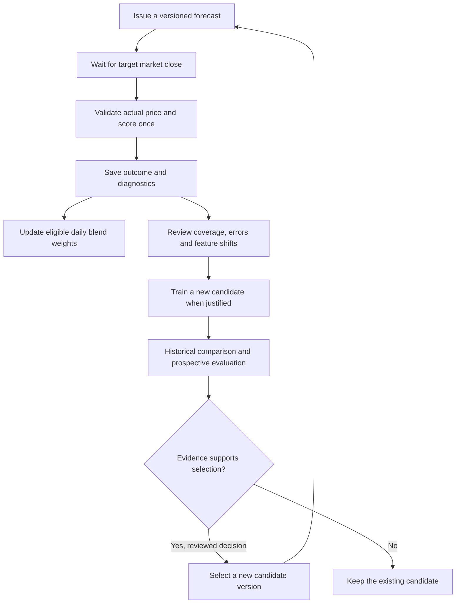

# The agent and the improvement loop

YodaX separates research from numerical prediction. Gemini handles conversation, source-based research and explanations. A scheduled worker builds the numerical features and runs a frozen forecasting model. This separation lets us check what was predicted, when it was issued and which inputs were used.

## One question through the system

1. The API saves the question under the browser's conversation owner.
2. The agent receives supported coverage, recent conversation context and available saved model outputs.
3. It researches RSS headlines, with at most one follow-up search, and returns a structured answer, citations, evidence map and optional forecast request.
4. The server validates references, graph structure, asset and horizon. The graph must connect evidence to an outlook.
5. A supported numerical request is saved for a separate worker. Existing saved results can be explained immediately; a new request is not instant inference.
6. The worker fetches prices and, for eligible event forecasts, attaches the current frozen candidate output. Missing event inputs leave the request queued.
7. Once the target close is available, the worker saves the outcome and error. Follow-up chat can explain that record.

Five-session requests for the 23-asset beta universe use the global-event candidate. Other supported US-equity horizons use TimesFM. The horizon begins at the worker's input cutoff. Physical demand questions and unsupported benchmarks receive research scenarios, not invented numerical forecasts.

Gemini uses `gemini-3.1-flash-lite`. Research is bounded by request caps and retries. The service runs one active research turn at a time and does not have a durable agent task queue. Completed conversations persist; interrupted work requires a retry.

## What actually improves automatically

The six-stock, one-session adaptive layer compares three experts: raw TimesFM, no change and bias-corrected TimesFM. After a settled prospective outcome, it lowers weights for larger normalized errors and updates a smoothed bias correction. The original forecast remains unchanged. State before and after the update is saved.

Weights start at 0.6, 0.2 and 0.2. The update uses exponential loss weighting with a small uniform mixture so no expert disappears permanently. Error is scaled by recent volatility, with a floor to avoid unstable scores in very quiet markets. A displayed score is `100 / (1 + normalized squared loss)`, not a probability or percentage of correct predictions. Reward means improvement relative to no change, not reinforcement learning.

This is an online update to a small blending layer. It does not backpropagate into TimesFM or Gemini. Longer-horizon chat outcomes do not train this six-stock learner.

## What requires a new model version

The event-aware adjustment is frozen. Scoring it does not retrain it. The next candidate needs a separate training run, chronological evaluation, artifact checks and an explicit selection decision.

The scoring and eligible daily blend steps run automatically. Review, retraining and candidate selection are deliberate steps. There is no autonomous model promotion, agent-policy training or guarantee that the next candidate will be better.

## Evidence a reader can inspect

- The methodology view shows settled forecasts and adaptive state changes.
- Chat predictions retain their cutoff, target, model route and later score.
- Model evidence links expose saved numerical records separately from news references.
- The private evaluation page compares candidate outcomes and shows worker failures.
- [Historical results](global-event-beta.md) and the [executed notebook](../notebooks/yodax_multi_asset_events.ipynb) show what was actually tested.

A sourced map explains the research context. It is not proof of causation, a hidden reasoning trace or a quantitative attribution of every feature. New headlines cannot revise an already-issued forecast.
