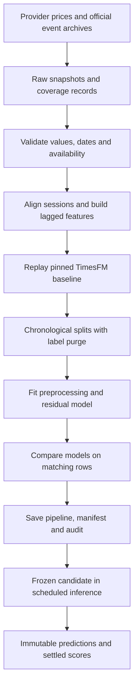

# From source data to a forecast

This guide describes the current 23-asset, five-session beta. The aim is to test whether structured global events add useful information beyond price history. We do not assume that more data means better predictions.

## Collection and schemas

Prices come through yfinance. Event records come from official GDELT v1 daily ZIP archives. These are provider downloads, not a crawler scraping arbitrary articles. Research chat separately reads news RSS feeds; those headlines are context for Gemini, not training features.

| Dataset | Normalized fields | Preparation and use |
| --- | --- | --- |
| Daily prices | `date, symbol, close, volume, split` | Preserve raw CSV, normalize dates, validate values and align sessions |
| Event records | `event_id, event_date, actor1_country, actor2_country, event_code, root_code, quad_class, date_added, source_url, archive_day, available_at` | Preserve ZIP, deduplicate event IDs within an archive, parse codes and aggregate daily |
| Daily events | `archive_day, available_at, event_total, verbal_cooperation, material_cooperation, verbal_conflict, material_conflict` | Build seven-day counts and shares only from available archives |
| Company exposure | Dated company/country disclosures and source references | Used by the older two-stock candidate, not the broader global candidate |
| Research sources | Title, publisher, published date, URL and source kind | Validate references and keep collection context with the conversation |
| FX display rates | Currency, rate and rate date | Convert displayed USD values; never train an FX forecast from these rates |

Raw price snapshots and event archives have content hashes. Coverage records include collection times and missing inputs. Normalized research datasets use Parquet. Training and live feature construction share Python modules in `research_pipeline/`.

## Coverage is smaller than the original ambition

The price archive starts in January 2015. The event archive used in this study starts in January 2025; the 2015–2024 event backfill is unfinished. The October 25 study had 641 event archive days through October 21, with 18 missing days from June 14 through July 1, 2025. Windows affected by missing event data are excluded. These are dated study counts, not a claim of continuous current coverage.

The broader study uses price context from 2023 and baseline cutoffs from 2025 through June 2026. Its final refit uses 7,859 settled asset/date rows. Earlier country-link notebooks describe different datasets and should not be pooled with this study without checking their definitions.

## Cleaning and alignment

Price checks cover required columns, duplicate dates, finite positive closes, nonnegative volume and missing assets. The feature builder aligns data to the XNYS session grid before calculating windows. A baseline needs 256 complete closing prices. Split-crossing contexts are rejected. Missing or split-affected future labels are excluded from settled training.

WTI and copper are continuous futures price proxies. They use the same reference session grid, but inference also waits for their own market close plus one hour. These series are not spot prices, official settlements or roll-adjusted investment returns. Nonpositive prices cannot be safely used in this percentage-return target.

Context series join on the exact date without forward filling. Missing numerical context can be handled by the fitted imputer; missing event archives are not interpreted as zero news. Current event inference fails closed when required coverage is incomplete.

Event occurrence and availability are different. Replay uses `archive_day + 2 days` as an availability assumption, and live inference enforces the same lag. It is a practical safeguard, not proof that every historical record was obtainable at that exact time. Vendor restatements and backfilled archives still limit point-in-time claims.

## Features and target

| Group | Features | Meaning |
| --- | --- | --- |
| Baseline | `baseline_return` | Frozen TimesFM expected return |
| Asset history | `return_1, return_5, return_20, volatility_20, volume_ratio` | Momentum, daily-return dispersion and volume relative to its rolling mean |
| Market context | `market_return_5, oil_return_5, copper_return_5` | Five-session moves in SPY, WTI and copper |
| Global events | Log seven-day event count, material-conflict share, material-cooperation share and coverage | Reporting intensity and event mix |
| Identity | One-hot encoded symbol | Asset-specific differences within the trained universe |

Returns are ratios minus one. Volatility is the rolling 20-session sample standard deviation of daily returns. Volume ratio divides volume by its 20-session mean. Event volume uses `log1p` to reduce the influence of large counts; shares normalize against total reporting volume. There is no general winsorization or claim that skewness has been removed.

The target is `close(t+5) / close(t) - 1`. The model learns the residual between this target and the TimesFM return. At inference, it adds its adjustment to the baseline. Future target values are separate from feature columns.

The saved sklearn Pipeline contains median imputation with missing indicators, symbol encoding and a `HistGradientBoostingRegressor`. Preprocessing is fitted only on training rows. The pipeline saves fitted preprocessing and the adjustment together; it still requires the pinned TimesFM baseline and the shared upstream feature builder.

## Splits, statistics and leakage controls

We use expanding chronological comparisons, not random train/test splits. All assets share date boundaries. Training labels that reach into evaluation are purged; evaluation labels outside their own window are excluded. The two comparison windows are September–December 2025 and January–June 2026. Some dates were used in earlier exploration, so these results are not an untouched final holdout.

Four models are evaluated on matching asset/date rows: no change, TimesFM, market-only adjustment and event-aware adjustment. Return MAE is primary; RMSE and direction are supporting measures. A paired moving-block bootstrap uses 20-session date blocks and 1,000 replications, keeping assets together by date and avoiding blocks across missing sessions. This accounts for some temporal and cross-asset dependence.

We have not run a user A/B test, ANOVA or chi-square test. Adding test names would not make this evaluation stronger. The useful question is whether the event model improves matched forecast errors, with uncertainty and stable performance across assets. No change had the lowest pooled MAE in both historical windows. See the [full results](global-event-beta.md).

Per-asset distribution summaries and standardized train/evaluation mean differences help identify skew, outliers and feature shifts. They do not prove absence of drift. There is no automated drift-based retraining gate yet.

## Correlation, causation and bias

The model learns predictive associations. An event can precede a price move without causing it. Interest rates, shared economic conditions and reporting intensity can influence both. The mind map records sourced reasoning, not an identified causal effect or a model feature-importance ranking.

A causal claim would need a specific mechanism, defensible treatment/control definition, timing and a design such as a carefully checked natural experiment. That work has not been completed here.

Known biases include today's selected stock universe, survival of successful firms, language and country differences in news coverage, retrospective vendor data, futures rolls and unknown overlap with TimesFM's pretraining data. Global event counts also miss company-specific supply chains. Physical production and demand are not labels in this model.

## Downstream contract and lineage

A prediction records candidate, symbol, cutoff, horizon/target, issue time, baseline revision, artifact/input hashes and recorded features. `shadow_predictions` identifies a comparison by candidate, symbol, cutoff and model. `prediction_requests` keeps browser ownership, requested horizon, state and the attached output. Actual values and scoring metadata are appended when available; original issued predictions stay fixed.

Artifact loading verifies checksums, dependency versions and baseline revision. Failed checks stop inference. Daily cloud runs retain selected normalized input artifacts for 30 days; this is not a complete permanent raw-data archive. Long-term replay storage is still needed before claiming full auditability.

Bad data is reduced through validation, explicit exclusions and review states. It is not eliminated. Monitor coverage, stale inputs, rejected rows, score delays and per-asset error before interpreting an apparent improvement.

Source references: [yfinance](https://github.com/ranaroussi/yfinance), [GDELT data](https://www.gdeltproject.org/data.html), [TimesFM](https://github.com/google-research/timesfm), [sklearn Pipeline](https://scikit-learn.org/stable/modules/generated/sklearn.pipeline.Pipeline.html).
