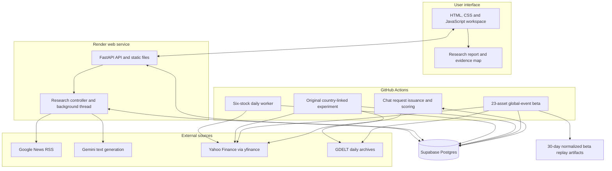
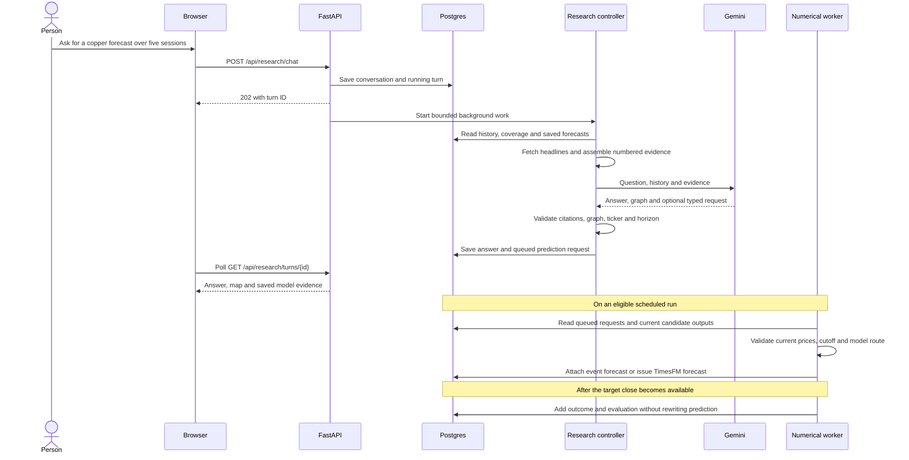

# System design

YodaX has two speeds of work. Chat research responds to a question. Numerical forecasting runs in scheduled workers after completed market sessions. Both use the same stored evidence, but they do not run in the same process.

This keeps the website small and lets us trace a forecast back to the model and data that produced it. It is a simple beta architecture, not a claim of tested capacity for a particular number of users.

## High-level design

## Component responsibilities

| Component | Responsibility | Deliberate boundary |
| --- | --- | --- |
| Browser | Display charts, chat, maps, reports and saved results | No provider credentials or numerical model weights |
| FastAPI | Validate requests, manage browser sessions, read results and coordinate research | Does not load TimesFM or train models |
| Gemini | Interpret questions, explain evidence and propose a typed forecast request | Cannot invent numerical targets or write directly to storage |
| Numerical workers | Fetch inputs, enforce calendars, run models and score outcomes | Do not use free-form chat sentiment as a trained feature |
| Postgres | Persist conversations, requests, forecasts, scores and learner state | Private request histories are owner-scoped |
| Research pipeline | Build datasets, compare candidates and save fitted preprocessing with the model | Does not automatically promote its output |

The web process uses `requirements-web.txt`. Public forecasting uses `requirements.lock.txt`. The event workers use `requirements-shadow.txt`, matching the serialized candidate environment. Local operation uses SQLite instead of Postgres.

## Request exchange

The controller may perform one focused follow-up news search. Each generation can retry once for selected transient or validation failures. Work is bounded by application quotas. A queued request is not an immediate model run. An answer can explain an already saved forecast while a new request is waiting.

## Storage design

| Tables | Purpose and identity |
| --- | --- |
| `forecasts` | Public forecasts keyed by symbol, target, TimesFM revision and historical/prospective kind |
| `dashboard` | Last successfully published dashboard snapshot |
| `adaptive_forecasts`, `learning_state` | Versioned one-session blend predictions and online state |
| `conversations`, `turns`, `conversation_owners` | Research history, progress and browser ownership |
| `prediction_requests` | One request per turn, with owner, symbol, horizon, state and model payload |
| `shadow_predictions` | Candidate, symbol, cutoff and model identify an immutable comparison forecast |
| `shadow_runs` | Worker outcomes, skips and failures |

Payload columns hold model-specific details. The [data guide](data-pipeline.md) describes their schema and lineage. This is a relational ledger with JSON payloads, not a feature store or a streaming platform.

## Failure handling and access

The deployed service runs one web worker. A process lock allows one active research turn at a time. Completed results survive restarts in Postgres. Interrupted research requires a retry; there is no durable task queue that resumes execution halfway through.

Signed browser cookies scope private conversations and requests. The private evaluation page uses a separate administrator token. Shared model-evidence links expose selected forecast fields, not conversation owners, credentials or worker logs. In cloud mode, origin checks restrict browser research requests to configured service origins.

Numerical jobs preserve the last successful dashboard if a run fails. Unavailable event inputs leave event requests queued rather than silently changing models. Corporate actions or restated prices can place an outcome into review. Database and workflow locks reduce duplicate work; saved prediction keys prevent overwriting originals.

## Why there is no Redis or Cassandra yet

Postgres is enough for the current ledger and request volume. Redis would fit a durable queue, shared rate limiter or short-lived cache if multiple web workers become necessary. Cassandra would only be worth considering for a much larger distributed time-series workload. Neither is part of this release, and neither fixes data quality or forecast accuracy.

Before claiming production scale, measure latency, concurrency, queue depth, failure recovery and storage growth. The current free hosting setup has no always-on availability guarantee.
